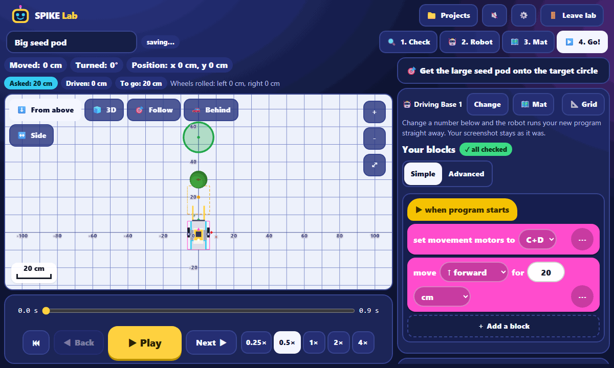
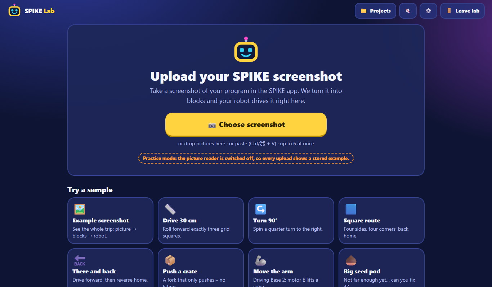
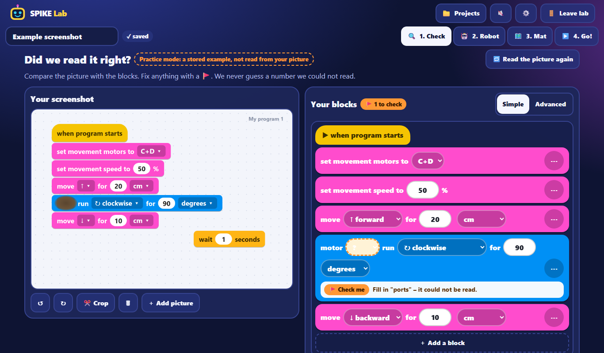
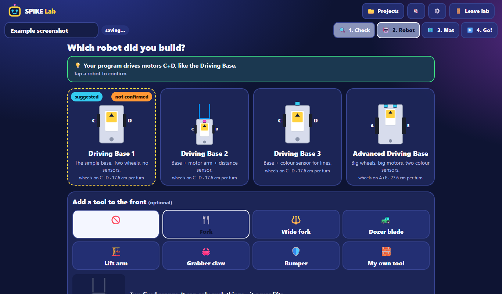
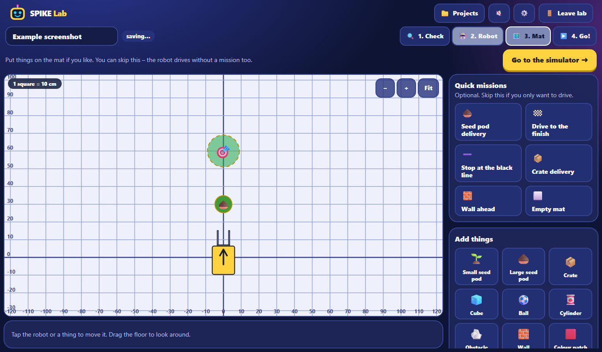
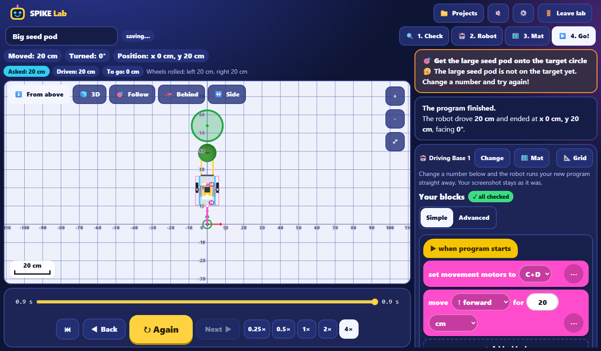
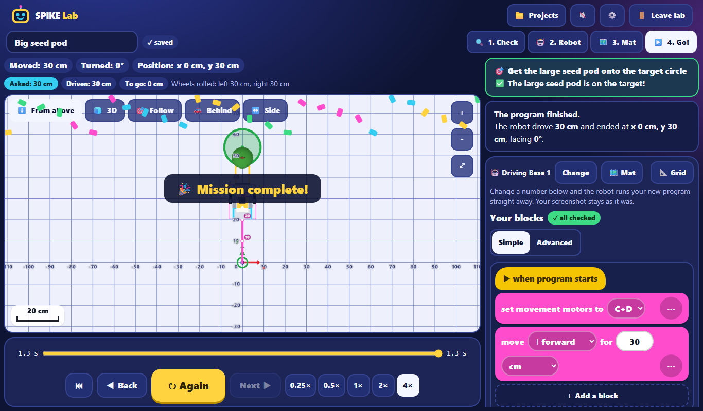
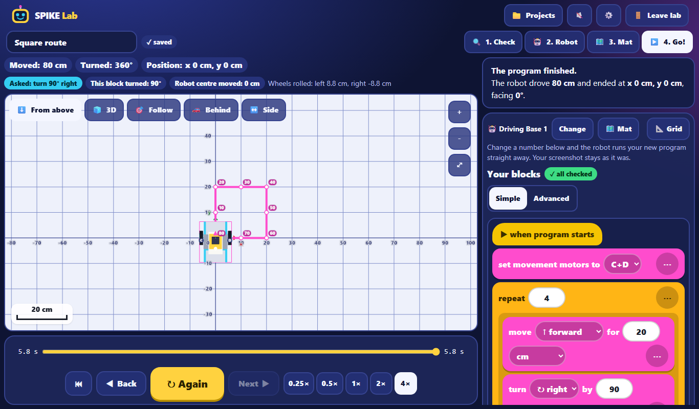

# SPIKE Lab

**Upload a screenshot of your LEGO® SPIKE™ Prime program and watch a robot drive it – no robot needed.**

*20 cm is not enough. Change one number, press play again, mission complete.*

**[▶ Try the demo](https://spike.o2ip.com/demo)** – no password, no sign-up. The demo runs without AI, so
uploads show a stored example; the samples and the whole simulator work for real.

## Why this exists

Without a robot it is hard to test a series of commands.

I built this for my son. He uses SPIKE Prime in the school robotics lab, and at home he was struggling to
picture what his exercises would actually do: he could write the program in the SPIKE app, but with no real
robot there was no feedback. Was "move forward 20 cm" enough? Did the turn go the right way? Why did the
mission fail?

SPIKE Lab gives him that feedback. He takes a screenshot of his program on the iPad, uploads it, and a
simulated robot runs **that exact program** on a measured grid. Then he changes a number and tries again,
right in the browser. It also turned out to be quicker than constantly tinkering with the real machines:
trying an idea takes seconds.

I did not even check whether something similar already existed. I was frustrated trying to work out how to
help him, and decided to build it in one go. So if you have the same problem, take it: install it on your
own website and run it there. All you need to bring is your own AI model (OpenAI, Gemini, or anything that
speaks the OpenAI format) – see [docs/setup.md](docs/setup.md).

*– Olaf*

It is built for children: big buttons, few words, iPad first – and it works on an iPhone held upright too.

## How it works

| 1. Upload a screenshot | 2. Check the blocks |
|---|---|
|  |  |
| One big button. Samples below for a first try. | The picture sits next to the blocks that were read from it. Anything unreadable gets a 🚩 and is **never guessed** – here a smudged motor port. |

| 3. Pick the robot | 4. Set up the mat (optional) |
|---|---|
|  |  |
| The program hints at the robot; the child confirms. Add a fork, lift arm, grabber or sensors. | Drop seed pods, crates, walls, lines and targets onto a 10 cm grid, or pick a ready-made mission. |

| 5. Run it | 6. Change a number, run again |
|---|---|
|  |  |
| 20 cm was not far enough. The readouts say exactly how far the robot went and where it ended. | Edit the block, the robot reruns at once. The original screenshot is kept untouched. |

More screens, including the 3D views and the iPad and iPhone layouts: **[the visual tour](docs/tour.md)**.

## What it can do

- **Reads real programs.** Movement, single motors, waits, loops, if/else, sensor conditions, variables,
  and several stacks running at the same time.
- **Measures like the lab floor.** A true-to-scale grid in centimetres (inches optional), a scale bar, and
  live readouts: *Moved 30 cm · Turned 90° · Position x 0 cm, y 30 cm*.
- **Step by step.** Play, pause, next instruction, previous instruction, a timeline, and speeds from ¼× to 4×.
  Stepping back restores everything – robot, tools, objects and variables.
- **Four robots.** Driving Base 1, 2 and 3 and the Advanced Driving Base, each with its own wheels and ports.
- **Tools and sensors.** Forks that only push, a lift arm and a grabber that follow their motor, colour,
  distance and force sensors.
- **Five cameras.** From above, free 3D, follow, behind and side.
- **Missions.** A goal such as "get the big seed pod onto the circle" is checked from the simulated result.
- **Your own table.** Practising for a competition? Photograph the real table once. SPIKE Lab straightens
  the photo into a true-size floor (about 236 × 114 cm, with a wall), you put blocks where the models stand,
  and every program can then be run on that table.

## What it is honest about

- **The movement is maths, not AI.** AI only reads the screenshot (and can explain a block in simple words).
  The robot's path is calculated with a fixed-step simulation, so the same program always gives the same result.
- **Nothing is invented.** A value the reader could not make out stays empty and blocks the run until the
  child fills it in. Blocks SPIKE Lab cannot run yet are shown, flagged and skipped.
- **Approximations are labelled.** Ports, wheel size and motor speeds come from official LEGO documents where
  they exist; everything else (track width, tool sizes, how objects slide) is an estimate, marked "≈" in the app
  and listed in [docs/robots.md](docs/robots.md). Pushing and lifting are simplified: things slide but do not tip.
- **A table picture is only a picture.** Places on it are as exact as the photo and the four corners you
  mark, so it is labelled "≈". No competition mat ships with SPIKE Lab: the picture is your own upload, and
  only the straightened mat is stored – never the original photo, which may show people.
- **One shared password is not privacy.** It keeps strangers out; it does not separate one child's projects
  from another's. The app says so. (The optional public demo is different: there each visitor only sees
  their own projects, and they are deleted after a day.)

## Under the hood

Vue 3 + TypeScript + Three.js in the browser, Laravel on the server, SQLite or MySQL.
The simulator itself is plain TypeScript with no framework, covered by 86 unit tests; 96 server tests and
60 browser tests (desktop, iPad landscape, iPad portrait, iPhone portrait) cover the rest.

**Why Laravel?** I have worked with it since version 5 and I like it. It is also a very good fit for
AI-assisted coding: the framework is opinionated, so there is one obvious place for everything and far less
to explain or correct.

| Read this | For |
|---|---|
| [docs/tour.md](docs/tour.md) | Every screen, with pictures |
| [docs/setup.md](docs/setup.md) | Running it locally, settings, tests, putting it on a server |
| [docs/architecture.md](docs/architecture.md) | How the simulator, the program format and the AI adapters fit together |
| [docs/robots.md](docs/robots.md) | Robot data: what is verified, what is estimated, and the sources |
| [docs/prompt.md](docs/prompt.md) | The original brief this was built from |

## Status

A working first version. The picture reader has been checked against a generated sample and needs more
practice on real iPad screenshots; only "when program starts" stacks run; the physics is deliberately simple.
The full list is at the end of [docs/setup.md](docs/setup.md).

## Licence

[MIT](LICENSE) – use it, change it, share it.

---

LEGO®, SPIKE™ and the Minifigure are trademarks of the LEGO Group, which does not sponsor, authorise or
endorse this project. SPIKE Lab is an independent learning tool.
