# A visual tour of SPIKE Lab

Every picture here is a real screenshot of the running app, taken by the automated browser tests
(`tests/e2e/shots.spec.ts`, and `tests/e2e/phone-tour.spec.ts` for the iPhone). Back to the [README](../README.md).

## The lab door

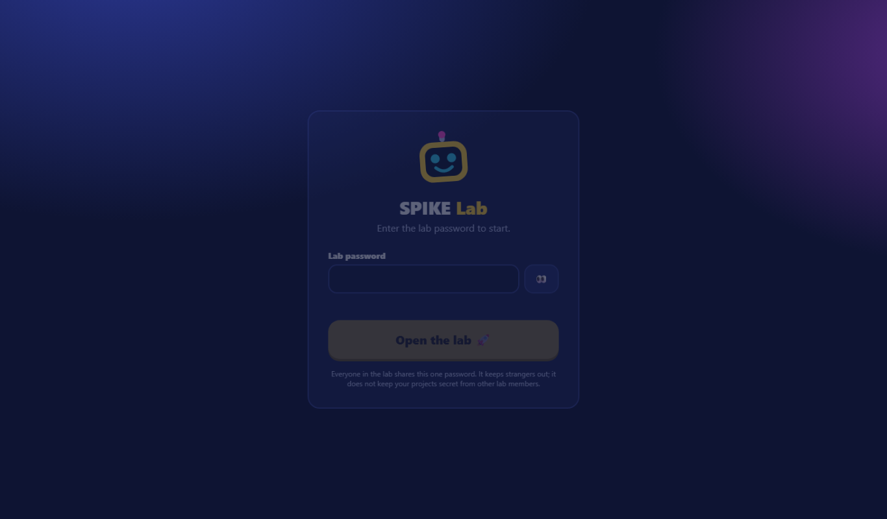

One shared lab password, checked on the server. There is a show/hide button, a clear message when the
password is wrong, and a short cooldown after several wrong tries.

## Home: upload first

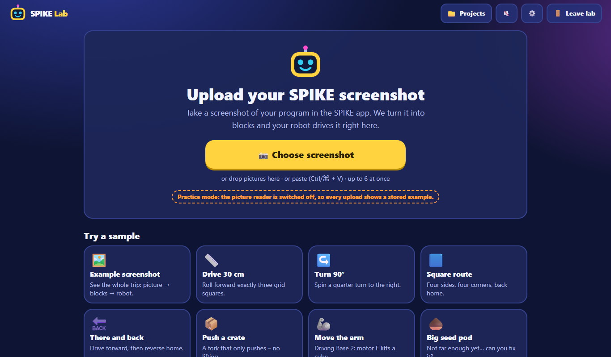

The main action is the upload. It takes pictures from the iPad photo library or Files, drag and drop on a
computer, or paste. Up to six screenshots can make up one long program. Below are sample exercises
(drive 30 cm, turn 90°, a square, pushing a crate, the motor arm, the big seed pod) and recent projects.

## Check: did we read it right?

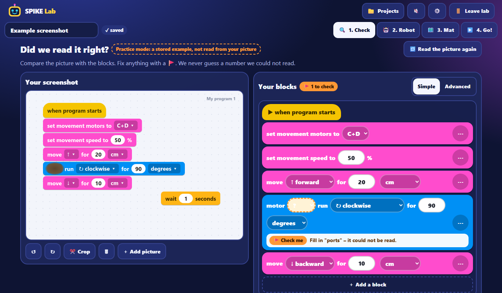

The original picture stays on the left; the blocks read from it are on the right, in the colours children
know from the SPIKE app. In this example the motor port was smudged, so the block carries a 🚩 and an empty
port – it is not guessed. Blocks that are not attached to a start block are listed separately and do not run.

Every number and dropdown can be changed. Blocks can be added, copied, moved and deleted with large buttons,
and the picture can be turned, cropped, reordered or read again.

## Robot: which one did you build?

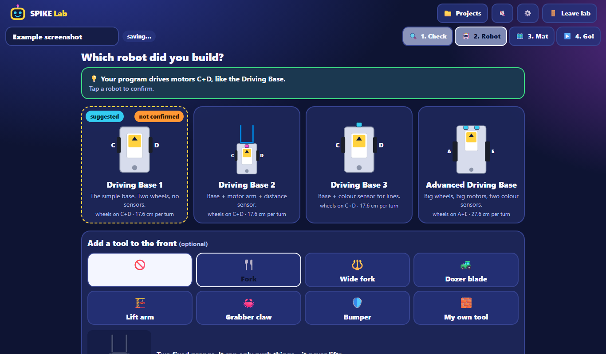

SPIKE Lab suggests a robot from the program (here: motors C+D means a Driving Base) and waits for a tap to
confirm. A tool can go on the front, sensors can be added, and "Ports and calibration" opens the exact
settings together with the list of what is official and what is estimated.

## Mat: build the mission

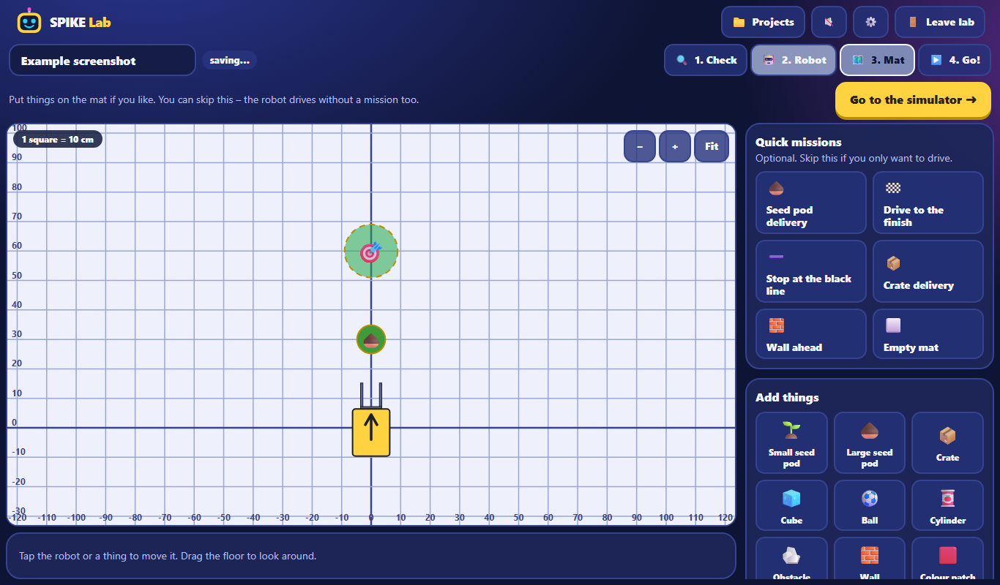

Optional. Things are dragged onto a grid where one square is 10 cm. Ready-made missions fill the mat in one
tap, and a goal can be chosen from what is on it.

## Go: watch it run

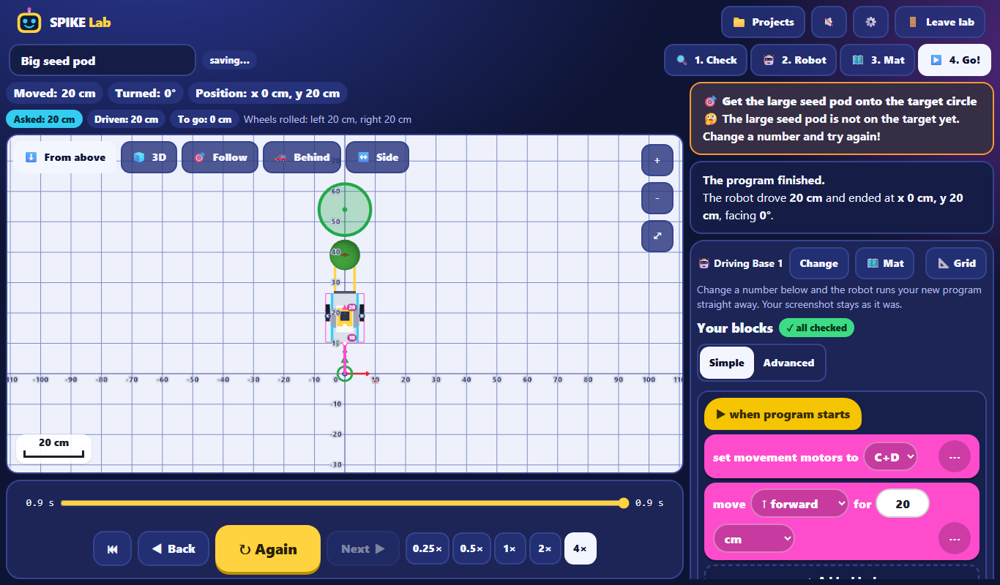

The view from above is the one to measure with. The chips at the top say how far the robot moved, how far it
turned and where it is; the second row compares what was asked with what was driven. The block that is
running is highlighted, and the side panel says in plain words how the run ended.

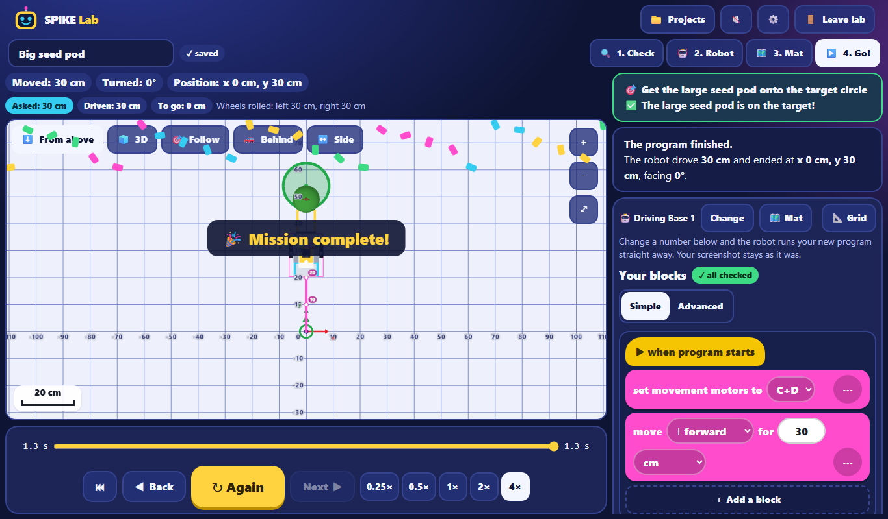

Change the number in the block and the robot runs the new program straight away.

### In 3D

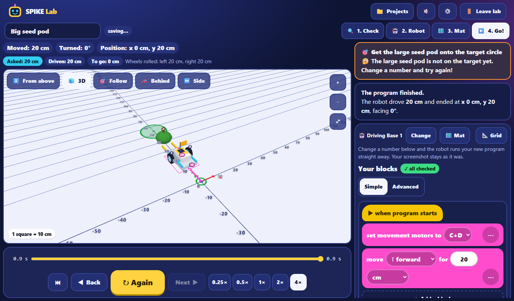

Switching camera never restarts or changes the run.

### A motor arm

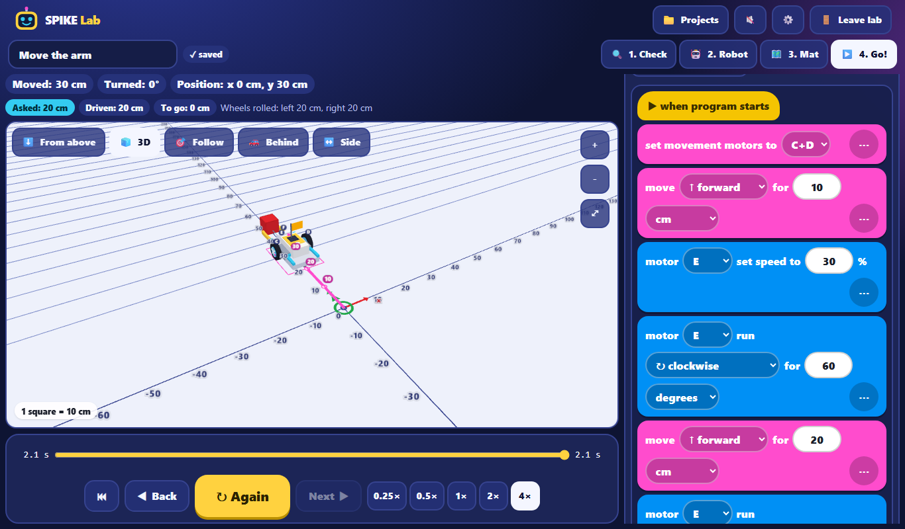

On Driving Base 2 the arm is on motor E. Running that motor raises the arm, and a cube touching the fork is
picked up and carried.

### Loops and turns

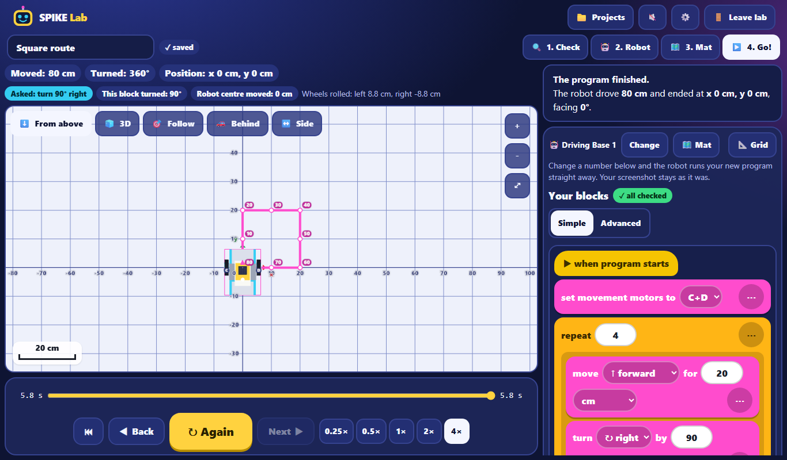

A repeat block drives four sides and four corners. The path stays on the mat with a marker every 10 cm.

## Your own table

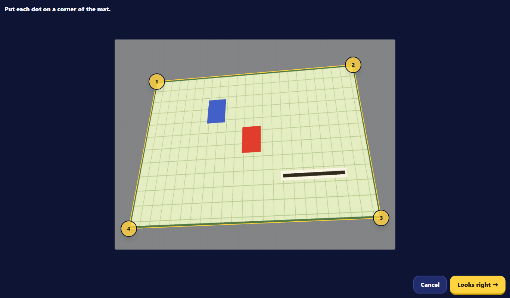

For competition practice the floor can be a photo of the real table. Choose a photo, put a dot on each
corner of the mat (a magnifier helps), and SPIKE Lab straightens it into a top-down floor at true size.
A corner that the photo cut off can sit outside the picture. iPhone photos (HEIC) work on any computer:
the app converts them itself. Only the straightened mat is kept; the photo itself never leaves the device.

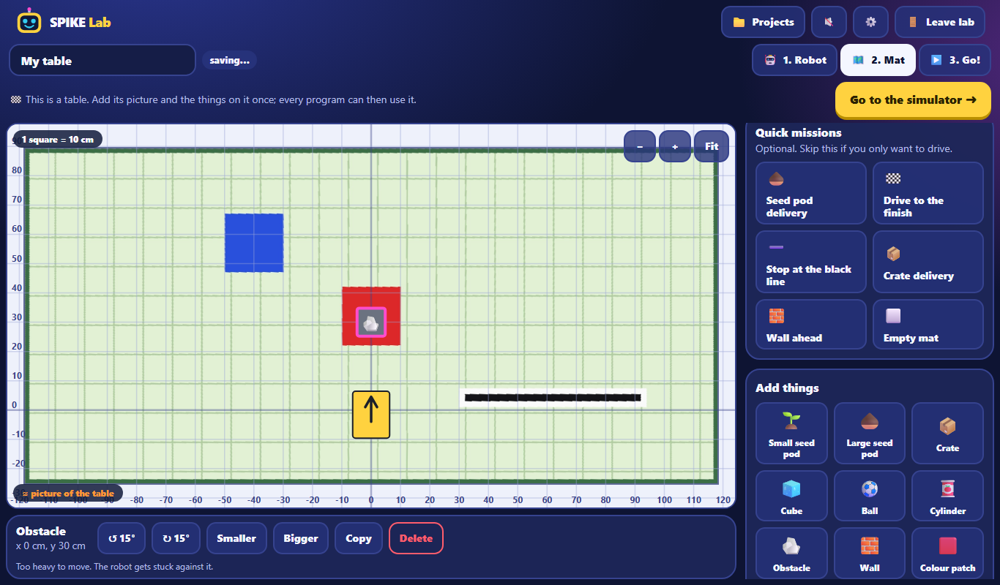

The competition table is about 236 × 114 cm with a wall around it. Blocks, lines and targets go on top of
the picture, and the robot can start anywhere. The picture carries a "≈" label: places on it are only as
exact as the photo and the four corners.

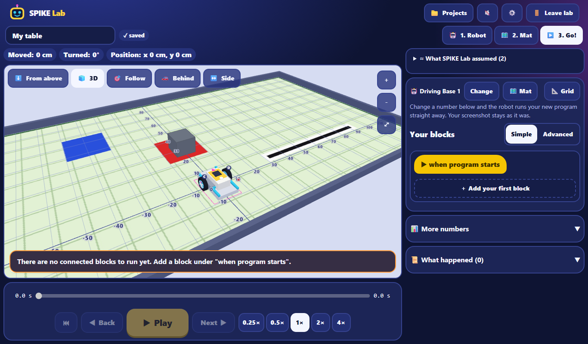

A table is made once and saved under **Tables** on the home screen. In any program, **Use a table** in the
Mat step copies it in – so a child can move things around without ever changing the saved table. The
pictures here use a made-up mat; SPIKE Lab does not come with any real competition mat.

## On an iPad

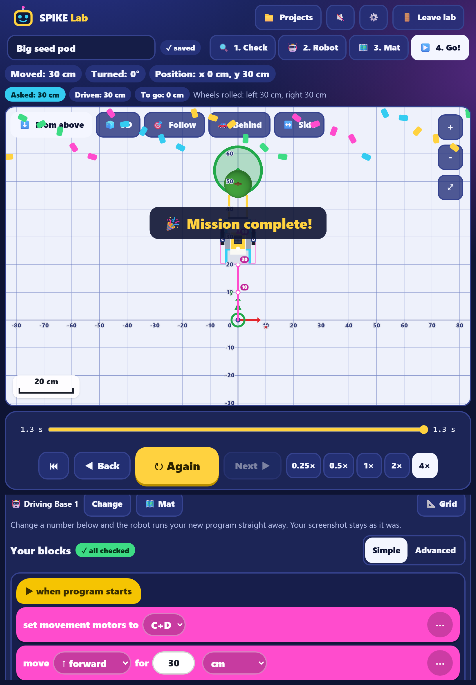

Portrait and landscape are both laid out on purpose: the stage on top, the big play controls under it, the
blocks below. Every button is at least 44 points tall, and nothing depends on hovering.

## On an iPhone

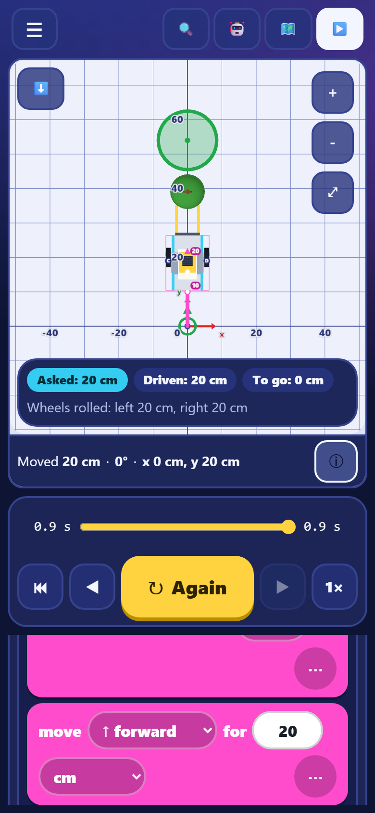
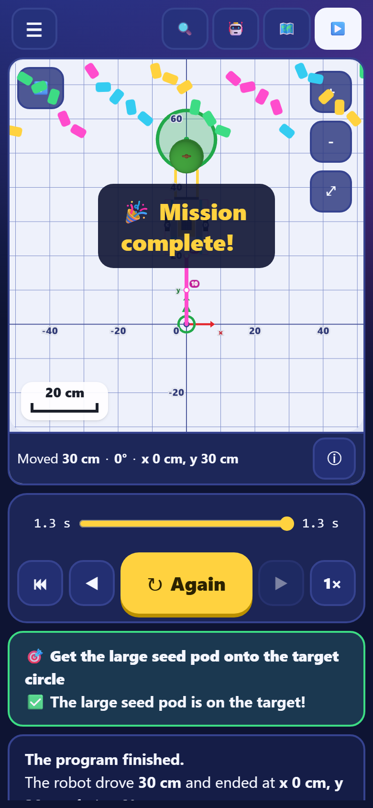
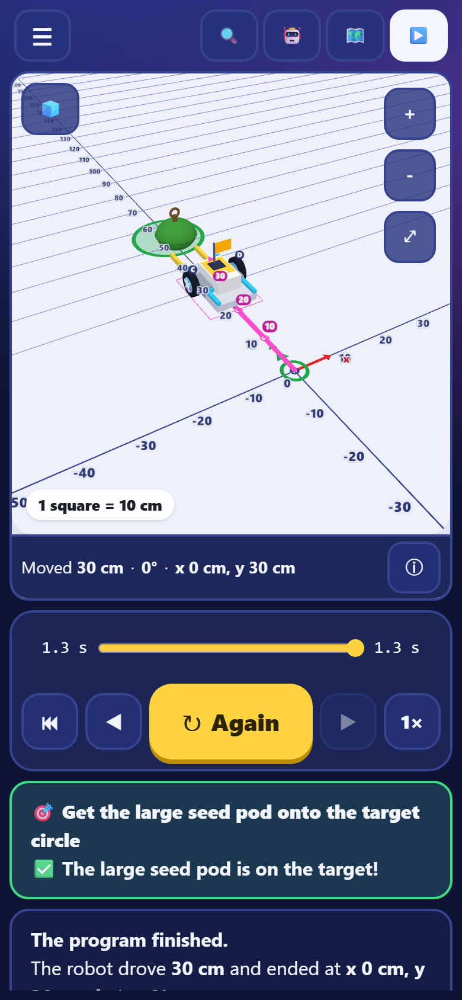

Held upright, a phone gets its own simpler layout, so the robot keeps about half the screen:

- **One top row.** The four steps, plus ☰ for the project name, projects, settings, sound and leaving the lab.
  If saving fails, a warning shows straight away, without opening ☰.
- **The numbers under the picture.** One line: how far the robot moved, how far it turned and where it is.
  ⓘ opens the numbers for the block that is running (asked, driven, to go, how far each wheel rolled).
  "≈ estimated" and "🧱 stuck" always stay on that line.
- **One camera button.** It shows the camera in use; tap it to pick another.
- **One row to play.** Back to the start, previous, Play, next, and one speed button that steps through
  ¼×, ½×, 1×, 2× and 4×. On the narrowest phones Play shows only its icon.
- **The blocks below**, so changing a number and pressing Play again happens on one screen.

Turned sideways, a phone uses the tablet layout. In Safari the toolbars take part of the screen; added to the
Home Screen, SPIKE Lab gets the whole height.
